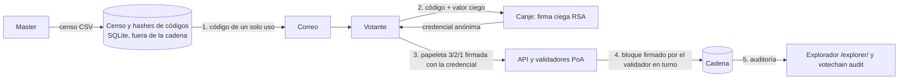

# VoteChain

Sistema de votación verificable para reconocer, cada semestre, a los administrativos y profesores de la Facultad de Ingeniería. Funciona como una papeleta estilo **Balón de Oro**: cada votante elige 3 personas por categoría y las puntúa 3, 2 y 1. El resultado se guarda en una cadena de bloques propia, y cualquier persona puede comprobarlo sin confiar en quien administra la elección.

> English summary: VoteChain is a permissioned blockchain voting system for a university award (Ballon d'Or style 3/2/1 ballot). Voters authenticate with a one-time email code, receive an anonymous credential through a blind signature, and cast a signed ballot. Anyone can verify the chain and recompute the tally. Status: prototype prepared for a controlled pilot; no independent third-party audit yet. License: to be defined.

**Estado:** prototipo preparado para un piloto controlado. Antes de usarlo con votantes reales hay que completar [`docs/checklist-seguridad.md`](docs/checklist-seguridad.md). La auditoría independiente por un tercero **está pendiente** (ver [Limitaciones](#limitaciones)). Licencia: **por definir**.

---

## Propuesta de valor

- **Un voto por persona habilitada**, sin doble voto, aplicado por reglas que cualquiera puede reproducir.
- **Resultado verificable**: el conteo se recalcula desde la cadena y se compara con el publicado.
- **Privacidad del voto**: el sistema sabe que una persona habilitada votó, pero no qué papeleta emitió, y el administrador no puede vincular credencial y persona.
- **Sin servicios de pago ni redes externas**. La única salida a internet es el servidor de correo (SMTP).

## El problema

El esquema actual asigna 2 votos por persona (1 administrativo y 1 profesor) y después hace una elección. Quien administra el proceso debe ser creído cuando anuncia el resultado. VoteChain busca que el resultado pueda auditarse por cualquiera, con los mismos datos y el mismo cálculo.

## Cómo se vota: papeleta 3/2/1

Por cada categoría (por ejemplo, `administrativo` y `profesor`):

| Posición | Puntos |
|---|---|
| 1.º pick | 3 |
| 2.º pick | 2 |
| 3.º pick | 1 |

- Exactamente **3 candidatos distintos**, ordenados. No hay voto en blanco ni papeletas parciales en la versión actual.
- Una papeleta por votante y categoría.
- Desempate: más primeros lugares, luego más segundos lugares. Si persiste, el empate se declara.

## Garantías

| Garantía | Cómo se logra | Cómo se comprueba |
|---|---|---|
| Solo personas habilitadas votan | Código de un solo uso enviado por correo, con expiración (10 min por defecto), guardado solo como hash | Censo cargado por el master; auditoría de emisiones |
| Un voto por credencial y categoría | La cadena rechaza el segundo `CAST_BALLOT` de la misma credencial | Reglas deterministas al reproducir la cadena |
| El emisor no vincula credencial con persona | Firma ciega RSA: el sistema firma sin ver el contenido, y el votante desciega la firma | Demo `demo_unlinkability.py` |
| La cadena no se puede alterar en silencio | Hash encadenado, raíz de Merkle por bloque, firmas Ed25519 de transacciones y bloques | `demo_tamper.py`, `votechain check`, `votechain audit` |
| El conteo es reproducible | Se deriva solo de la cadena; las papeletas inválidas se ignoran de forma determinista | Explorador web y `votechain audit` |
| Comprobante individual | El votante recibe un `tx_id` y puede verificar que su papeleta está incluida en un bloque | `/explorer/` (sección de comprobante) |

**Lo que no garantiza:** la protección frente a coerción y compra de votos (ver [Limitaciones](#limitaciones)).

## Flujo de una elección



1. **Código por correo.** El master carga el censo. El votante recibe un código de un solo uso y lo presenta una vez.
2. **Credencial anónima.** El navegador del votante genera una clave Ed25519 y oculta (ciega) un mensaje con ella. El servidor firma el mensaje ciego sin verlo y el votante obtiene una firma válida sobre su clave. La credencial es esa clave más la firma.
3. **Papeleta.** El votante firma la papeleta con su clave de credencial. La transacción no contiene correo, nombre ni identificador personal.
4. **Cadena.** Los validadores PoA (uno por turno, `índice mod N`) incluyen la papeleta en un bloque firmado. Las reglas de dominio se aplican al reproducir la cadena.
5. **Auditoría.** El explorador y el comando `votechain audit` recalculan hashes, Merkle y conteo de forma independiente.

## Arquitectura resumida

| Componente | Responsabilidad | Ubicación |
|---|---|---|
| Cadena (`block`, `blockchain`, `transactions`, `merkle`) | Bloques encadenados, génesis fijo, transacciones firmadas | `src/votechain/` |
| Consenso PoA (`consensus`) | Conjunto de validadores, turno round-robin, bloques firmados | `src/votechain/consensus.py` |
| Red (`network`, `p2p_http`) | Propagación de transacciones y bloques, sincronización, resolución de forks | `src/votechain/network.py`, `p2p_http.py` |
| Dominio de votación (`voting`) | Estado derivado de la cadena, papeleta 3/2/1, conteo y desempate | `src/votechain/voting.py` |
| Autenticación (`auth`, `blind`) | Censo, códigos por correo, firma ciega | `src/votechain/auth/`, `blind.py` |
| API (FastAPI) | Rutas de master, votante y lectura pública; sirve el explorador | `src/votechain/api/` |
| Interfaz web (Next.js) | `/votar` (flujo del votante) y `/master` (panel del administrador) | `frontend/` |
| Explorador | Bloques, conteo y verificación en el navegador (JavaScript sin build) | `web/` |
| CLI `votechain` | Operación, diagnóstico y auditoría | `src/votechain/cli.py` |

**Validadores:** 3 por defecto (5 con el perfil `extended`). No publican puertos al host. La API actúa como nodo observador de la red.

**Persistencia:** cada servicio guarda su estado en un volumen (`/data`): cadena, censo y códigos (SQLite) y claves de emisión.

## Instalación y uso rápido

### Requisitos

- Docker y Docker Compose (para el piloto).
- Para desarrollo: Python 3.11 o superior, [uv](https://docs.astral.sh/uv/) y Node.js 22 (para `frontend/`).

### Levantar el piloto local

```bash
# 1. Genera .env con secretos (permisos 600, no versionar).
uv run votechain init --validators 3

# 2. Levanta validadores, API y frontend.
docker compose up --build -d

# 3. Diagnóstico: código de salida 0 = todos los nodos responden con la misma cadena válida.
docker compose exec api votechain check
```

Direcciones (solo en `127.0.0.1` por defecto):

- Interfaz del votante y del master: http://127.0.0.1:3000 (`/votar`, `/master`)
- API: http://127.0.0.1:8000
- Explorador público: http://127.0.0.1:8000/explorer/

> **Antes de un piloto real** configura `VOTECHAIN_SMTP_*` en `.env`. Sin `VOTECHAIN_SMTP_HOST` se usa un buzón de desarrollo que guarda los códigos **en claro**. Revisa [`docs/checklist-seguridad.md`](docs/checklist-seguridad.md).

### Ciclo de una elección (CLI)

Los comandos de `election` necesitan la URL de la API y el token de master, que `init` deja en `.env`:

```bash
V="uv run votechain --env .env election"
API="--api http://127.0.0.1:8000"

$V $API create ELE-2026-1                                   # borrador
$V $API category ELE-2026-1 administrativo                  # categoría
$V $API candidate ELE-2026-1 administrativo CAND-01 "Nombre Apellido"
$V $API voters ELE-2026-1 censo.csv                         # CSV con una columna de correos
$V $API code ELE-2026-1 persona@dominio.edu                 # envía (o reenvía) un código
$V $API open ELE-2026-1                                     # requiere >= 3 candidatos por categoría
$V $API close ELE-2026-1
$V $API tally ELE-2026-1                                    # el conteo se publica solo al cierre
```

Guía completa del master: [`docs/guia-master.md`](docs/guia-master.md).

### Auditoría independiente

```bash
uv run votechain audit ELE-2026-1 \
  --nodes v1=http://nodo1:9000,v2=http://nodo2:9000,v3=http://nodo3:9000 \
  --validators PK1,PK2,PK3 \
  --api http://127.0.0.1:8000
```

`--validators` debe recibir las claves públicas de los validadores **obtenidas por fuera de la red**, no las que informe el sistema. Código de salida distinto de 0 indica discrepancia. Procedimiento completo: [`docs/guia-auditoria.md`](docs/guia-auditoria.md).

### Demostraciones y pruebas

```bash
uv run python demo_tamper.py         # altera un bloque y muestra dónde se rompe la cadena
uv run python demo_unlinkability.py  # el master intenta vincular credenciales con votantes
uv run pytest                        # suite de pruebas (incluye la elección end-to-end)
```

Desarrollo del frontend:

```bash
cd frontend && npm install && npm run dev   # requiere la API en VOTECHAIN_API_URL (def. http://127.0.0.1:8000)
```

## Limitaciones

Estas limitaciones son conocidas y están documentadas. No se deben omitir al comunicar el sistema.

**Privacidad y coerción**

- **No resiste coerción ni compra de votos.** Quien obtiene el `tx_id` de un comprobante puede localizar la papeleta en la cadena pública y ver sus picks. Además, un votante puede demostrar su voto.
- **Correlación por tiempo e IP** entre el canje del código y la emisión de la papeleta. Recomendación para el piloto: votar con retraso y desde otra red.
- **El master sabe qué correos canjearon código** (registro de emisiones), aunque no puede vincularlos con una credencial concreta.
- **El master puede emitir credenciales a no votantes.** Se detecta comparando emisiones con papeletas en la auditoría, pero el sistema no lo impide.
- La credencial del votante vive en `sessionStorage` del navegador hasta que se muestra el comprobante.

**Disponibilidad y consenso**

- **Sin view-change.** Si el validador en turno está caído, la cadena se detiene. La API responde 503 y la acción **no** se aplica; al levantar el validador, la cadena continúa.
- **P2P sin autenticación entre pares.** Los bloques están firmados por validadores conocidos, pero los endpoints `/p2p/*` no autentican a quien llama.
- Red permisionada: no es una cadena pública.

**Seguridad operativa**

- **Token de master estático**, configurado en `.env`. Rotarlo requiere reiniciar la API.
- **Todas las claves de validador pueden estar en un único `.env`** si un solo host las aloja. Cada operador debe recibir solo su clave.
- **Claves de emisión y `auth.db` sin cifrar en disco.** Usa disco cifrado y respaldos cifrados.
- **TLS, CSP y rate limiting no están en el código.** Deben configurarse en un proxy inverso delante de la API y del frontend.
- El buzón de desarrollo guarda los códigos en claro (solo para pruebas).

**Verificación**

- **Auditoría humana por un tercero: PENDIENTE.** La prueba automatizada (`python -m votechain.e2e`, `tests/test_pilot_e2e.py`) verifica el mecanismo, pero no sustituye la independencia de un auditor.
- **El explorador no verifica firmas en el navegador.** Recalcula hashes, Merkle y conteo. Para verificar firmas usa `votechain audit`.

**Producto**

- Sin voto en blanco ni con menos de 3 picks.
- El ranking se publica solo al cierre.
- La interfaz no muestra contadores de censo ni de códigos, ni permite deshabilitar un votante.

## Roadmap

### Completado (changes archivados, en orden)

1. `blockchain-core`: bloques encadenados por hash, génesis fijo y validación.
2. `signed-transactions`: firmas Ed25519, raíz de Merkle, mempool y PoW didáctico.
3. `p2p-poa-consensus`: red de nodos y consenso Proof of Authority por turnos.
4. `voting-domain-borda`: papeleta 3/2/1, reglas de dominio y conteo con desempate.
5. `voter-email-auth`: censo y códigos de un solo uso por correo.
6. `anonymous-credentials`: credencial anónima por firma ciega.
7. `master-admin-api`: API del master y lectura pública.
8. `public-audit-explorer`: explorador, verificación en el navegador y comprobantes.
9. `web-voting-and-admin`: interfaz del votante y panel del master.
10. `pilot-deployment`: `docker compose`, CLI de operación, guías y prueba end-to-end.

Especificaciones vigentes: [`openspec/specs/`](openspec/specs/).

### Pendiente (sin change abierto)

- Auditoría humana independiente de una elección de prueba.
- Decisiones abiertas de `docs/context.md`: proveedor SMTP y dominio de correo, fuente del censo y de candidatos, número de validadores y quién los opera, visibilidad del ranking antes del cierre, voto en blanco.
- Limitaciones técnicas de la sección anterior: view-change, cifrado de claves en reposo, autenticación entre pares, verificación de firmas en el explorador.
- Licencia del repositorio.

Estos puntos no tienen fecha comprometida.

## Documentación

- [`docs/context.md`](docs/context.md): contexto del proyecto, decisiones tomadas y abiertas.
- [`docs/guia-master.md`](docs/guia-master.md): despliegue, ciclo de elección y recuperación.
- [`docs/checklist-seguridad.md`](docs/checklist-seguridad.md): verificaciones previas al piloto.
- [`docs/guia-auditoria.md`](docs/guia-auditoria.md): auditoría por un tercero.
- [`openspec/`](openspec/): especificaciones, changes y archivo (flujo OpenSpec).

## Contribuir

Los cambios de comportamiento se planean como changes de OpenSpec, uno a la vez: propuesta, specs con escenarios verificables, diseño, tareas, implementación y archivo. Antes de proponer un cambio, ejecuta `uv run pytest`.

## Licencia

**Licencia por definir.** La elección de licencia es una decisión pendiente del titular del repositorio. Hasta que se publique un archivo de licencia, no se concede permiso explícito para usar, copiar, modificar o distribuir este código.
